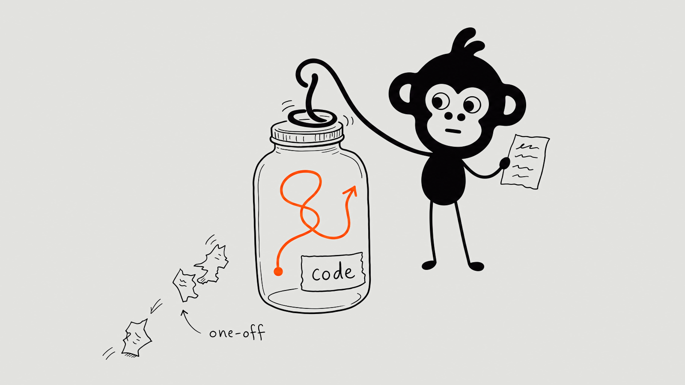
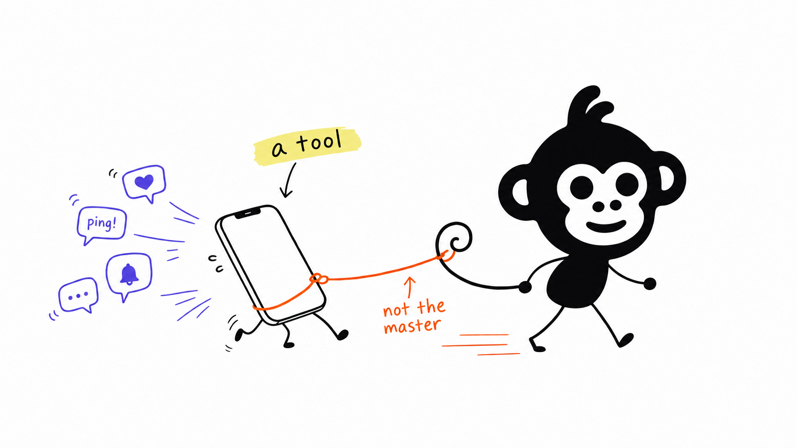
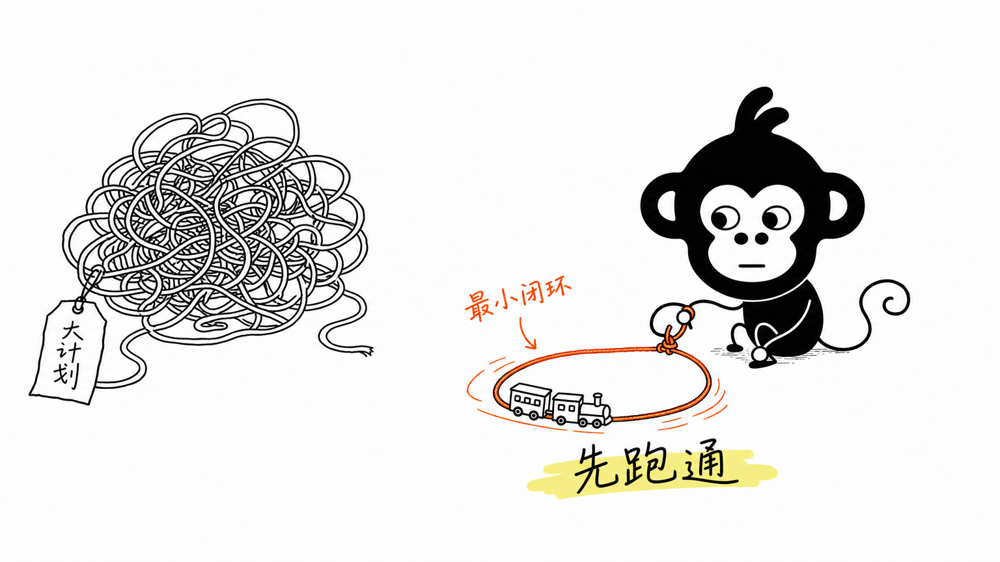
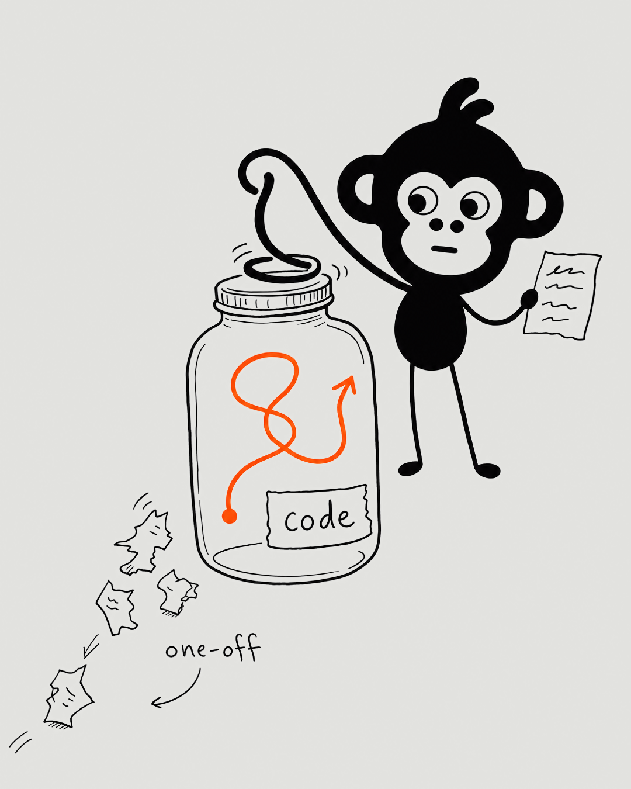

# Chan Monkey Illustrations

> Hand-drawn illustrations for articles and social posts, starring Chan Meng's brand monkey.
>
> Agent Skill for Claude Code and Codex · OpenAI `gpt-image-2` · English or Chinese labels



Give it an article or a post. It finds the one or two ideas worth drawing, invents a physical
metaphor for each, and generates a picture in which the monkey from the
[chanmeng.org](https://chanmeng.org) logo does the work that explains the idea.

Image models are bad at keeping a character on-model from a text description, so this skill
doesn't describe the monkey's head; it **sends the logo as a reference image** with every
generation. The head comes back as the real mark: the solid ink silhouette, the white face, the
curl sweeping up to the right.

## What it makes

- **A shot list:** where each figure goes, its idea, its structure, what the monkey does and its
  mood, and the label words.
- **One PNG per figure**, in the size the destination needs:

  | `--size` | pixels | for |
  |---|---|---|
  | `article` (default) | 1536×864, 16:9 | blog posts, docs, newsletters |
  | `linkedin` | 1080×1350, 4:5 | LinkedIn feed |
  | `x` | 1600×900, 16:9 | X feed |

- **The prompt behind every image**, saved in `prompts/` beside it, so any figure can be
  regenerated.

It doesn't make slides, infographics, architecture diagrams, posters or mascot stickers.

## The character

| frozen: the logo | free: added so it can work |
|---|---|
| solid ink head, round ears with white inner crescents | a small rounded ink body |
| white heart-shaped face, round eyes, two nostril dots, a smile | thin line arms and legs |
| the two-strand curl sweeping up to the right | a long curly tail, used as a third hand |
| | ten expressions, from the mood set of the website's animated monkey |

Anything drawn over the black head is in brand colour, never ink on ink. The full spec is in
[`references/monkey-ip.md`](chan-monkey-illustrations/references/monkey-ip.md).

## Style

White page, thin wobbly ink line, a lot of empty space, and the chanmeng.org palette used
sparingly:

| ink `#070607` | orange `#FC5000` | violet `#524AE9` | glare `#F5F28E` |
|---|---|---|---|
| line art, the monkey | the main flow, the one thing that moves | AI, system state, side notes | one highlighter swipe |

For social posts, `--ground basalt` swaps the white page for the brand's `#E2E2DF` after
generation, so the image matches the rest of the feed visuals. The monkey's face knockout takes
the ground colour too, as it does on the real logo.

## Examples

| | |
|---|---|
|  |  |
| *Article, English:* technology is a tool you walk, not a master that walks you. | *Article, Chinese:* close the smallest loop that works before the big plan. |



*LinkedIn, 4:5 on basalt.* The X version at the top of this page was recomposed from this one,
so both platforms carry the same picture. The prompts are in [`examples/prompts/`](examples/prompts).

These calibrate density and how the monkey takes part. They are not templates: every article
gets its own metaphor.

## Install

The skill is the inner folder, `chan-monkey-illustrations/`.

**Claude Code**

```bash
git clone https://github.com/ChanMeng666/chan-monkey-illustrations.git
cp -r chan-monkey-illustrations/chan-monkey-illustrations ~/.claude/skills/
pip install -r ~/.claude/skills/chan-monkey-illustrations/requirements.txt
```

To keep the installed copy in sync with the clone, link it instead of copying (on Windows,
`New-Item -ItemType Junction -Path $HOME\.claude\skills\chan-monkey-illustrations -Target <clone>\chan-monkey-illustrations`).

**Codex**

```bash
cp -r chan-monkey-illustrations/chan-monkey-illustrations "${CODEX_HOME:-$HOME/.codex}/skills/"
```

**API key:** set `OPENAI_API_KEY` in the environment, or in a `.env` in your working directory
or in the skill folder (see [`.env.example`](chan-monkey-illustrations/.env.example)).
`OPENAI_BASE_URL` works for OpenAI-compatible endpoints; `OPENAI_IMAGE_MODEL` defaults to
`gpt-image-2`.

## Use

```text
Use chan-monkey-illustrations to plan the figures for content/digital-minimalism.mdx. Shot list only.
```

```text
Use chan-monkey-illustrations to generate 4 illustrations for this article and save them in public/blog/<slug>/.
```

```text
用 chan-monkey-illustrations 给这篇文章生成 3 张猴子正文配图。
```

```text
Edit 03-handoff.png: the curl is sweeping the wrong way. Fix only the head.
```

Or call the script directly:

```bash
python chan-monkey-illustrations/scripts/generate_image.py --prompt-file brief.txt --out out/01-idea.png
python chan-monkey-illustrations/scripts/generate_image.py --prompt-file brief.txt --out out/post.png --size linkedin --ground basalt
python chan-monkey-illustrations/scripts/generate_image.py --edit out/01-idea.png --prompt "Remove the text ..." --out out/01-idea.png
```

It never overwrites: if `01-idea.png` exists it writes `01-idea-v2.png`, unless you pass
`--overwrite`.

## With linkedin-post-skill

[linkedin-post-skill](https://github.com/ChanMeng666/linkedin-post-skill) writes Chan's LinkedIn
and X posts. It uses this skill as its default visual for posts that have no structure to
diagram: it writes a brief from the post's one idea, renders the LinkedIn version, then
recomposes it for X (`scripts/render-monkey.mjs` there). Numbers and architecture are still
drawn by code there; the image model only ever draws the monkey.

## How it works

1. **Digest** the text and find the cognitive anchors: a claim, a turn, a before/after, a loop.
2. **Shot list**, one anchor per figure.
3. **Invent the metaphor:** an abstract claim becomes a physical verb, the system becomes a
   low-tech object, and the verb goes to the monkey (often to its tail).
4. **Generate** one image per call, with the logo attached as reference.
5. **QA** every image against [`references/qa-checklist.md`](chan-monkey-illustrations/references/qa-checklist.md):
   the head on-model, the monkey as the actor, labels spelled right, the colour jobs respected.
6. **Save** with the prompt beside each image and report what goes where.

## Layout

```text
chan-monkey-illustrations/          # the skill
├── SKILL.md
├── agents/openai.yaml              # Codex metadata
├── references/
│   ├── monkey-ip.md                # the character
│   ├── style-dna.md                # page, line, palette, labels, social post profile
│   ├── composition-patterns.md     # structures and the metaphor method
│   ├── prompt-template.md          # generation and edit prompts, calibration notes
│   └── qa-checklist.md
├── scripts/generate_image.py       # OpenAI Images edit + reference, sizes, ground swap
├── assets/monkey/                  # monkey-reference.png (1024², black on white) + source SVG
└── assets/examples/                # calibration images
examples/                           # the images and prompts shown in this README
```

`monkey-reference.png` is rendered from
[`chan-meng-monkey-black-on-white.svg`](https://github.com/ChanMeng666/chan-meng-personal-brand-logo)
at 760 px on a 1024 px white square. If the logo changes, re-render it.

## Credits

The workflow is adapted from
[Ian Xiaohei Illustrations](https://github.com/helloianneo/ian-xiaohei-illustrations) by Ian
(MIT). See [NOTICE.md](NOTICE.md).

## License

Code and docs are MIT. The monkey mark is Chan Meng's personal brand: see [NOTICE.md](NOTICE.md).
